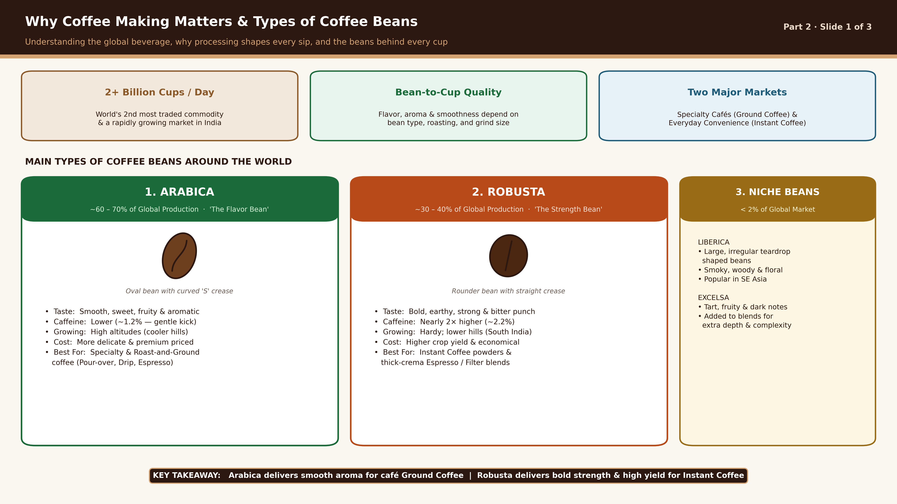
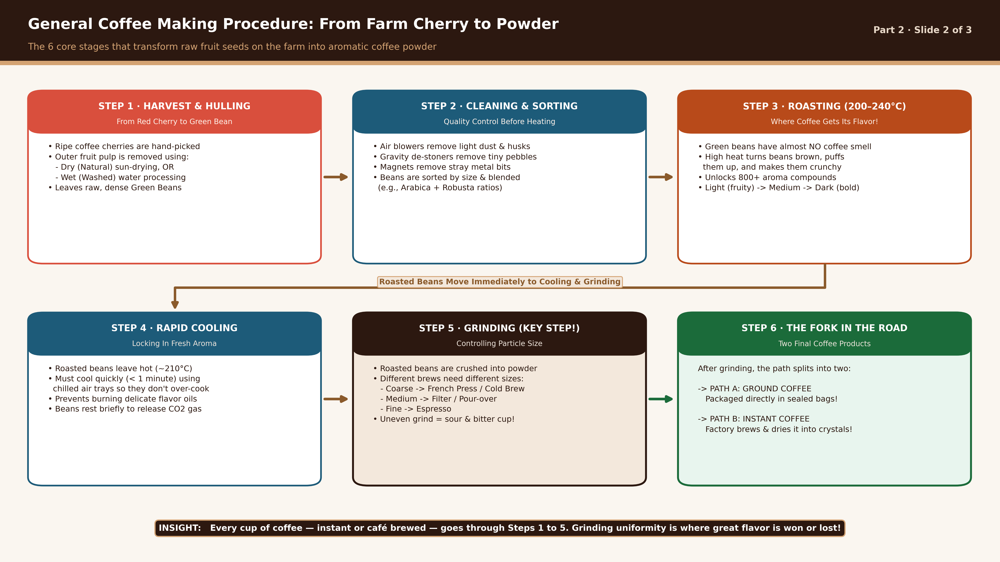
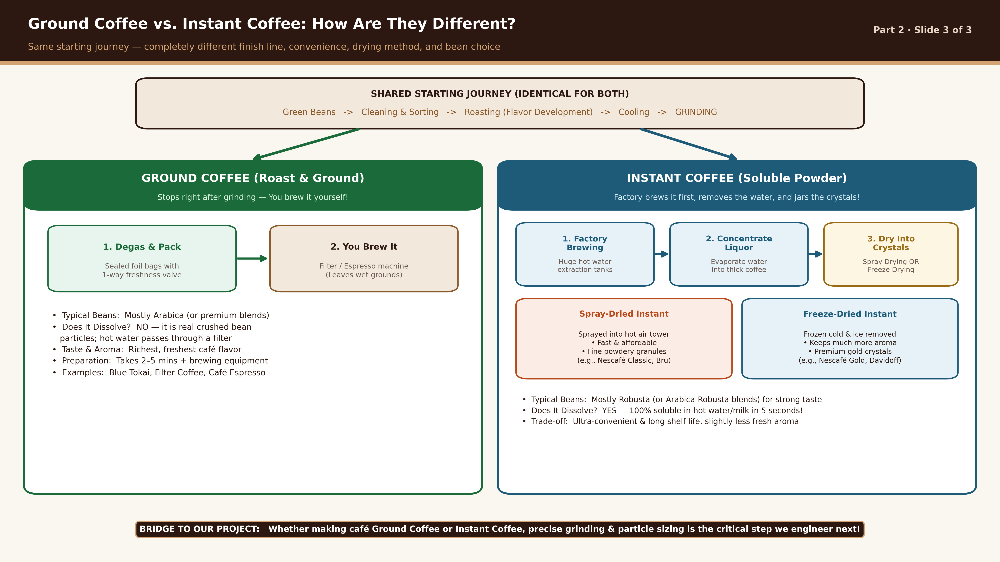
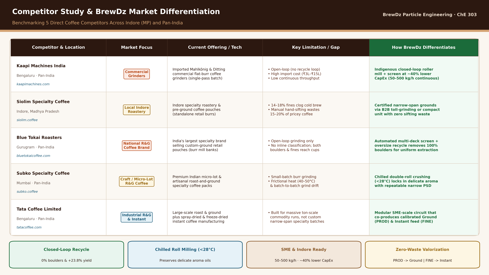

# Part 2: The Coffee Making Process — 3-Slide Audience Overview
## Simple, Engaging, Math-Free Guide: Why Coffee, Types of Beans, General Procedure & Ground vs. Instant
**Course:** ChE 303 — Fluid Particle Systems  
**Project:** BrewDz Particle Engineering Pvt. Ltd.  
**Goal:** Give the audience a clear, intuitive, general understanding of coffee making in **3 slides** (no heavy math or equations).  
**Speaking Time:** ~3.5 to 4.5 minutes (~1–1.5 minutes per slide).

---

## Quick 3-Slide Flow

1. **Slide 1 — Why Coffee Making Matters & Types of Coffee Beans:** Why coffee is huge globally & in India, plus Arabica vs. Robusta (and Liberica/Excelsa).
2. **Slide 2 — General Coffee Making Procedure (Farm Cherry to Powder):** The 6 simple stages from picking red cherries to roasting, cooling, and grinding.
3. **Slide 3 — Ground Coffee vs. Instant Coffee (How Are They Different?):** Same start, different finish line — how instant coffee is brewed and dried (spray vs. freeze drying), and which beans each uses.

---

### SLIDE 1: Why Coffee Making Matters & Types of Coffee Beans

* **Ready-to-Insert Visual (16:9 HD PNG & SVG):**
  * PNG: [slide1_beans_and_why.png](file:///d:/Desktop/Brewdz-Che-303/docs/slide_visuals/slide1_beans_and_why.png)
  * SVG: [slide1_beans_and_why.svg](file:///d:/Desktop/Brewdz-Che-303/docs/slide_visuals/slide1_beans_and_why.svg)
  * 

#### Bullet Points on Slide:
* **Why Coffee Making?**
  * Over **2 billion cups** consumed every day — one of the world's largest beverage industries, with fast-growing café & instant markets in India.
  * Raw coffee seeds have almost no flavor; **how we process, roast, and grind the bean** decides the entire taste of the cup.
* **The Main Types of Coffee Beans:**
  1. **Arabica (~60–70% of world market — "The Flavor Bean"):**
     * Oval bean with a curved S-shaped crease; grown in cooler high-altitude hills.
     * Smooth, sweet, fruity, aromatic, and lower in caffeine (~1.2%).
     * Used primarily for **specialty & Roast-and-Ground coffee**.
  2. **Robusta (~30–40% — "The Strength Bean"):**
     * Rounder bean with a straight crease; hardy and widely grown in South India (Coorg, Chikmagalur).
     * Bold, earthy, strong bitter punch, nearly **double the caffeine (~2.2%)**, and higher crop yield.
     * Used primarily for **Instant Coffee** and thick-crema espresso / South Indian filter blends.
  3. **Niche Beans (<2%):** **Liberica** (large smoky/woody beans) and **Excelsa** (tart, fruity notes added to specialty blends).

#### Natural Speaker Script (~1 – 1.5 minutes):
> *"Before we dive into our engineering design, let's take a quick look at how coffee is actually made and what beans go into our cups.*
> 
> *Coffee is one of the most popular beverages on the planet—over two billion cups are consumed every single day, and India's coffee culture is growing rapidly across both specialty cafés and everyday instant coffee. Interestingly, the flavor in your cup doesn't exist in the raw seed; it is completely created by how the bean is chosen, roasted, and ground.*
> 
> *Almost all the coffee we drink comes from two main bean varieties. First is **Arabica**, making up around 60 to 70 percent of the global market. Grown in cooler high-altitude hills, Arabica is smooth, sweet, aromatic, and lower in caffeine—which is why cafés and specialty ground coffee brands prefer it. Second is **Robusta**, which grows well at lower altitudes—including right here in South India. Robusta has almost double the caffeine, a much bolder, stronger taste, and higher yield, making it the go-to bean for instant coffee and strong filter blends. Alongside these two, niche beans like Liberica and Excelsa make up less than 2 percent of the market for unique smoky or fruity blends."*

---

### SLIDE 2: General Coffee Making Procedure (From Farm Cherry to Powder)

* **Ready-to-Insert Visual (16:9 HD PNG & SVG):**
  * PNG: [slide2_general_process.png](file:///d:/Desktop/Brewdz-Che-303/docs/slide_visuals/slide2_general_process.png)
  * SVG: [slide2_general_process.svg](file:///d:/Desktop/Brewdz-Che-303/docs/slide_visuals/slide2_general_process.svg)
  * 

#### Bullet Points on Slide:
* **Step 1 — Harvest & Hulling (Cherry to Green Bean):** Ripe red coffee cherries are picked; the fruit pulp is removed by sun-drying (Dry/Natural method) or washing (Wet method), leaving hard **Green Coffee Beans**.
* **Step 2 — Cleaning & Sorting:** Air blowers remove dust and husks, de-stoners separate tiny pebbles, magnets remove stray metal, and beans are graded by size and blended.
* **Step 3 — Roasting (200–240°C):** High heat turns raw green beans brown, puffs them up, makes them crunchy, and unlocks **800+ aroma compounds** (Light roast = fruity, Medium = balanced, Dark = bold).
* **Step 4 — Rapid Cooling:** Hot beans are cooled rapidly with air in under a minute so they don't keep cooking or burn delicate aroma oils.
* **Step 5 — Grinding (The Turning Point!):** Roasted beans are broken into powder sized for the brewing method — **Coarse** (French Press), **Medium** (Filter / Pour-over), or **Fine** (Espresso). Uneven grinding causes sour and bitter flavors at the same time.
* **Step 6 — The Fork in the Road:** After grinding, the journey splits into **Ground Coffee** (packed directly) or **Instant Coffee** (brewed & dried in the factory).

#### Natural Speaker Script (~1 – 1.5 minutes):
> *"Now, how does a fruit on a farm actually become coffee powder? Every coffee—whether instant or café-style—follows the same general procedure up to grinding.*
> 
> *First, coffee actually starts as the seed inside a ripe red cherry. Farmers pick the cherries and strip away the outer fruit pulp—either by sun-drying or washing—to get raw green coffee beans. Second, at the processing facility, these green beans are thoroughly cleaned using air blowers, de-stoners, and magnets, then sorted and blended.*
> 
> *Third comes **roasting**, which is where the magic happens. Raw green beans actually smell a bit like grass! Heating them to around 200 to 240 degrees Celsius browns the beans, puffs them up, makes them crunchy, and creates over 800 rich aroma compounds. Fourth, the beans are cooled rapidly with air so they don't over-roast.*
> 
> *Fifth is **grinding**—turning whole roasted beans into powder. Depending on how you brew it, you need coarse grounds for French Press, medium for filter coffee, or fine for espresso. And this is the key step: if the grind is uneven, your coffee tastes simultaneously sour and bitter. Right after grinding, the process hits a fork in the road between Ground Coffee and Instant Coffee."*

---

### SLIDE 3: Ground Coffee vs. Instant Coffee — How Are They Different?

* **Ready-to-Insert Visual (16:9 HD PNG & SVG):**
  * PNG: [slide3_ground_vs_instant.png](file:///d:/Desktop/Brewdz-Che-303/docs/slide_visuals/slide3_ground_vs_instant.png)
  * SVG: [slide3_ground_vs_instant.svg](file:///d:/Desktop/Brewdz-Che-303/docs/slide_visuals/slide3_ground_vs_instant.svg)
  * 

#### Bullet Points on Slide:
* **Same Start, Different Finish Line:** Both go through Green Beans $\to$ Cleaning $\to$ Roasting $\to$ Cooling $\to$ Grinding.
* **Ground Coffee (Roast & Ground):**
  * **Stops right after grinding!** Packed directly into sealed bags with a one-way freshness valve.
  * **Does NOT dissolve** — it is real crushed bean powder; you brew it yourself through a filter and throw away the wet grounds.
  * Typically uses **Arabica** (or premium blends) for maximum fresh café aroma (e.g., Blue Tokai, South Indian Filter Coffee).
* **Instant Coffee (Soluble Powder):**
  * **Goes 3 extra steps inside the factory:**
    1. *Factory Brewing:* Giant hot-water tanks brew the grounds into strong liquid coffee.
    2. *Concentration:* Excess water is evaporated to make a thick coffee concentrate.
    3. *Drying into Crystals:* Either **Spray Drying** (sprayed into hot air $\to$ affordable powder like Nescafé Classic / Bru) or **Freeze Drying** (frozen & ice removed gently $\to$ premium rich gold crystals like Nescafé Gold / Davidoff).
  * **100% dissolves** in hot water or milk in 5 seconds with zero leftover grounds; typically uses **Robusta** (or Arabica-Robusta blends) for strong taste and higher yield.
* **Bridge to Our Project:** Whether making ground coffee or instant coffee, **consistent grinding and particle size control** is the decisive step that our startup **BrewDz** solves!

#### Natural Speaker Script (~1 – 1.5 minutes):
> *"So how is instant coffee actually different from regular ground coffee? Many people assume they come from different plants, but they actually share the exact same journey all the way through roasting and grinding.*
> 
> *On the left, **Ground Coffee** simply stops right after grinding. The crushed beans are sealed into freshness bags and sold straight to you. Because it's real crushed bean particles, it does not dissolve—you pass hot water through it using a filter or espresso machine, and you throw away the wet grounds. It usually uses Arabica beans and gives the freshest, richest café aroma.*
> 
> *On the right, **Instant Coffee** is essentially coffee that the factory has already brewed for you and then turned back into dry crystals. After grinding, huge factory tanks brew the coffee into a strong liquid, evaporate away most of the water, and dry it in one of two ways: **Spray Drying**, which sprays the liquid into hot air to make affordable everyday coffee like Nescafé Classic, or **Freeze Drying**, which freezes the liquid and gently removes the ice to keep much more aroma, creating premium gold crystals like Nescafé Gold or Davidoff. Instant coffee commonly uses Robusta blends for a stronger kick, and dissolves completely in hot water in seconds.*
> 
> *And this brings us directly to our project: whether you stop at Ground Coffee or continue to Instant Coffee, the **grinding step** is where particle uniformity makes or breaks the product—which is exactly what our BrewDz process engineers next!"*

---

## Simple Audience / Professor Q&A Cheat-Sheet (No Heavy Math)

1. **Q: Why do instant coffee companies mostly use Robusta beans instead of 100% Arabica?**
   * *A:* Robusta beans are hardier, more economical, give a higher extract yield during factory brewing, and keep a strong coffee punch even after high-heat drying. Premium freeze-dried instant coffees often blend in Arabica for extra aroma.
2. **Q: What is the difference between Wet (Washed) and Dry (Natural) processing on the farm?**
   * *A:* In the **Dry/Natural** method, whole cherries dry in the sun with the fruit still on, giving a sweeter, fruitier bean. In the **Wet/Washed** method, the fruit pulp is washed off before drying, giving a cleaner, brighter taste.
3. **Q: Why does Freeze-Dried instant coffee cost more than Spray-Dried instant coffee?**
   * *A:* Spray drying uses hot air, which is fast and cheap, but some delicate coffee aroma evaporates away. Freeze drying freezes the brewed coffee and removes ice gently under vacuum—it takes much more time and energy, so it costs more, but preserves far more real coffee aroma.
4. **Q: Why can't you just dissolve ground coffee directly in water like instant coffee?**
   * *A:* Ground coffee is made of solid roasted plant cell walls (cellulose), which don't dissolve in water. Instant coffee has already had all the insoluble solids filtered out at the factory—only the water-soluble coffee essence is left in the jar!

---

## BONUS SLIDE: Competitor Study & Market Differentiation (Table Slide)

* **Ready-to-Insert Visual (16:9 HD PNG & SVG):**
  * PNG: [slide_competitor_study.png](file:///d:/Desktop/Brewdz-Che-303/docs/slide_visuals/slide_competitor_study.png)
  * SVG: [slide_competitor_study.svg](file:///d:/Desktop/Brewdz-Che-303/docs/slide_visuals/slide_competitor_study.svg)
  * 

### Comparison Table (5 Direct Coffee Competitors — Copy-Paste Version)

| Competitor & Location | Market Focus | Current Offering / Tech | Key Limitation / Gap | How BrewDz Differentiates |
| :--- | :--- | :--- | :--- | :--- |
| **Kaapi Machines India** Bengaluru · Pan-India [kaapimachines.com](https://kaapimachines.com/) | **Commercial Grinders** | Imported Mahlkönig & Ditting commercial flat-burr coffee grinders (single-pass batch) | Open-loop (no recycle loop); high import cost (₹3L–₹15L); low continuous throughput | Indigenous closed-loop roller mill + screen at ~40% lower CapEx (50–500 kg/h continuous) |
| **Siolim Specialty Coffee** Indore, Madhya Pradesh [siolim.coffee](https://siolim.coffee/) | **Local Indore Roastery** | Indore specialty roastery & pre-ground coffee pouches (standalone retail burrs) | 14–18% fines clog cold brew; manual hand-sifting wastes 15–20% of pricey coffee | Certified narrow-span grounds via B2B toll-grinding or compact unit with zero sifting waste |
| **Blue Tokai Roasters** Gurugram · Pan-India [bluetokaicoffee.com](https://bluetokaicoffee.com/) | **National R&G Coffee Brand** | India's largest specialty brand selling custom-ground retail pouches (burr mill banks) | Open-loop grinding only; no inline classification, so both boulders & fines reach cups | Automated multi-deck screen + oversize recycle removes 100% boulders for uniform extraction |
| **Subko Specialty Coffee** Mumbai · Pan-India [subko.coffee](https://subko.coffee/) | **Craft / Micro-Lot R&G Coffee** | Premium Indian micro-lot & artisanal roast-and-ground specialty coffee packs | Small-batch burr grinding; frictional heat (40–50°C) & batch-to-batch grind drift | Chilled double-roll crushing (<28°C) locks in delicate aroma with repeatable narrow PSD |
| **Tata Coffee Limited** Bengaluru · Pan-India [tatacoffee.com](https://tatacoffee.com/) | **Industrial R&G & Instant** | Large-scale roast & ground plus spray-dried & freeze-dried instant coffee manufacturing | Built for massive ton-scale commodity runs, not custom narrow-span specialty batches | Modular SME-scale circuit that co-produces calibrated Ground (`PROD`) & Instant feed (`FINE`) |

### Natural Speaker Script (~1.5 minutes):
> *"Next, let's look at our Competitor Study across Indore and India. We benchmarked five direct coffee competitors—covering commercial grinder suppliers, specialty roast-and-ground brands, and large-scale industrial coffee producers—and identified a very clear market gap.*
> 
> *First, on the commercial equipment side, **Kaapi Machines** in Bengaluru imports German Mahlkönig and Swiss Ditting burr grinders. They are industry benchmarks for cafés, but they cost 3 to 15 lakh rupees per unit, operate in small open-loop batches, and have zero oversize recycle.*
> 
> *Next, looking at specialty roast-and-ground brands—**Siolim Specialty Coffee** right here in Indore, **Blue Tokai** nationally, and **Subko** in Mumbai—all rely on open-loop burr grinding. As a result, fines clog cold brew filters, boulders still slip into customer pouches, frictional heating can reach 40 to 50 degrees, and manual hand-sifting wastes up to 20 percent of expensive beans.*
> 
> *Finally, at the massive industrial scale, **Tata Coffee** produces both ground and instant coffee—but their multi-ton plants are built for commodity volume, not flexible narrow-span batches for growing specialty roasters.*
> 
> ***BrewDz fills this exact white space:** we offer an affordable, SME-sized closed-loop chilled double-roll crusher and vibrating screen—keeping grinding cool below 28 degrees, recycling 100 percent of boulders for 23.8 percent higher yield, and co-producing both calibrated ground coffee and instant-coffee fines with zero waste."*
