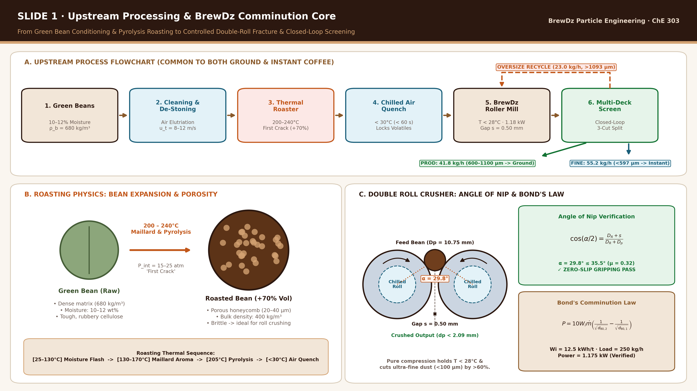
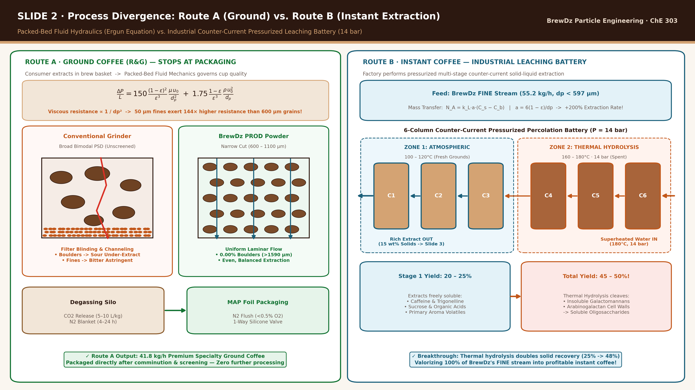
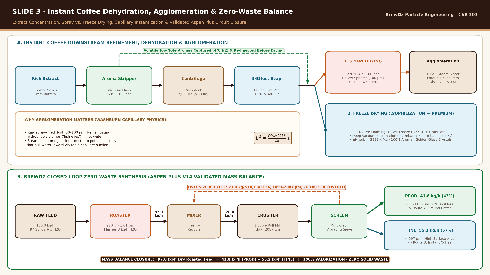

# Part 2: The Industrial Coffee Making Process — 3-Slide Master Presentation Deck
## High-Impact Chemical Engineering Presentation Plan (Maximum 3 Slides)
**Course:** ChE 303 — Fluid Particle Systems  
**Project:** BrewDz Particle Engineering Pvt. Ltd.  
**Topic:** Part 2 — The Complete Coffee Making Process: Ground Coffee (R&G) vs. Instant (Soluble) Coffee  
**Presentation Time:** 5 to 6 minutes (~2 minutes per slide)  

---

## Executive 3-Slide Architecture Overview

```
┌────────────────────────────────────────────────────────────────────────────────────────┐
│ SLIDE 1: UPSTREAM OPERATIONS & COMMINUTION CORE (Raw Bean to Engineered Particles)     │
│  • Green Bean Cleaning & Density De-Stoning                                            │
│  • Pyrolysis Roasting Kinetics & Cellular Expansion (Porosity Generation)              │
│  • BrewDz Chilled Double Roll Crusher (Angle of Nip α = 29.8°, Bond's Law P = 1.18 kW)│
│  • Multi-Deck Screen Split: PROD (Ground Coffee) vs. FINE (Instant Coffee Feed)        │
└───────────────────────────────────────────┬────────────────────────────────────────────┘
                                            │
                                            ▼
┌────────────────────────────────────────────────────────────────────────────────────────┐
│ SLIDE 2: THE PROCESS DIVERGENCE: ROUTE A (GROUND) vs. ROUTE B (INSTANT EXTRACTION)     │
│  • The Fundamental Boundary: Ground stops at packaging; Instant extracts in factory    │
│  • Route A (Ground Coffee): Packed-Bed Hydraulics, Ergun Equation (viscous loss ∝ 1/dp²)│
│    Eliminating filter blinding & channeling; N2 degassing packaging with 1-way valve   │
│  • Route B (Instant Leaching): Counter-current percolation battery (5-8 cols, 14 bar) │
│    Thermal hydrolysis (180°C) boosts yield to 48%; BrewDz fines accelerate mass transfer│
└───────────────────────────────────────────┬────────────────────────────────────────────┘
                                            │
                                            ▼
┌────────────────────────────────────────────────────────────────────────────────────────┐
│ SLIDE 3: INDUSTRIAL DEHYDRATION, AGGLOMERATION & ZERO-WASTE MASS BALANCE               │
│  • Clarification (Centrifugation at 7,000 g) & Falling-Film Vacuum Evaporation (40% TS)│
│  • Spray Drying (220°C hollow spheres) vs. Freeze Drying (Lyophilization at 0.2 mbar)  │
│  • Steam Agglomeration & Washburn Capillary Suction: Lump-free instant solubility      │
│  • BrewDz Closed-Loop Closure: 42 kg/h PROD + 55 kg/h FINE = 100% Zero-Waste Balance  │
└────────────────────────────────────────────────────────────────────────────────────────┘
```

---

### SLIDE 1: Upstream Operations & Comminution: From Green Bean to Engineered Particles

* **Slide Title:** Upstream Processing & Comminution Mechanics
* **Subtitle:** Green Bean Conditioning, Pyrolysis Roasting & Controlled Double-Roll Fracture
* **Ready-to-Insert Slide Visual (300 DPI PNG & Vector SVG):**
  * PNG: [slide1_upstream_comminution.png](file:///d:/Desktop/Brewdz-Che-303/docs/slide_visuals/slide1_upstream_comminution.png)
  * SVG: [slide1_upstream_comminution.svg](file:///d:/Desktop/Brewdz-Che-303/docs/slide_visuals/slide1_upstream_comminution.svg)
  * 

#### Slide Text & Bullet Points:
* **1. Raw Green Bean Conditioning:**
  * Feed moisture: $10\text{--}12\text{ wt}\%$; bulk density: $\approx 680\text{ kg/m}^3$.
  * Pneumatic elutriation at terminal velocity ($u_t = 8\text{--}12\text{ m/s}$) + fluidized vibrating de-stoner ($\rho_{\text{stone}} > 2000\text{ kg/m}^3$).
* **2. Thermal Roasting & Pyrolysis Kinetics ($200\text{--}240^\circ\text{C}$):**
  * **$25\text{--}130^\circ\text{C}$:** Free moisture evaporation (drops to $2.5\%$).
  * **$130\text{--}170^\circ\text{C}$:** Maillard reaction & Strecker degradation (melanoidins & pyrazine flavor formation).
  * **$200\text{--}215^\circ\text{C}$ ("First Crack"):** Internal vapor pressure ($15\text{--}25\text{ atm}$) expands bean volume by $50\text{--}100\%$, forming a brittle cellular honeycomb ($20\text{--}40\,\mu\text{m}$ pores).
  * Rapid chilled-air quench ($<30^\circ\text{C}$ in $<60\text{ s}$) arrests pyrolysis and traps volatile aromatics.
* **3. Precision Comminution & Screening (BrewDz Core):**
  * Chilled water-jacketed double rolls eliminate frictional heat ($T_{\text{mill}} < 28^\circ\text{C}$) and minimize shear.
  * **Angle of Nip Verification:** $\cos(\alpha/2) = (D_R + s)/(D_R + D_p) \implies \alpha = \mathbf{29.8^\circ \le 35.5^\circ}$ ($\mu = 0.32$, **verified zero-slip gripping**).
  * **Bond's Comminution Power:** $P = 10 \cdot W_i \cdot \dot{m} (1/\sqrt{d_{80,2}} - 1/\sqrt{d_{80,1}}) = \mathbf{1.175\text{ kW}}$ at $250\text{ kg/h}$ total load.
  * Multi-deck screen splits crushed effluent: Oversize recycled ($23\text{ kg/h}$), on-spec product separated (`PROD`), and fines harvested (`FINE`).

#### Speaker Script (Word-for-Word ~1.5 - 2 minutes):
> "Good morning, respected evaluators. In our presentation on the industrial coffee making process, we begin with Slide 1: Upstream Processing and Comminution Mechanics. 
> 
> All coffee manufacturing—whether for ground coffee or instant soluble powder—shares the same upstream preparation. Raw green coffee beans arrive at 10 to 12 percent moisture. They first pass through pneumatic elutriators and fluidized vibrating de-stoners, which use differences in terminal settling velocity to reject dense stones and foreign debris. 
> 
> The cleaned beans enter the roaster at 200 to 240 degrees Celsius. As the temperature crosses 200 degrees, exothermic pyrolysis occurs—known as the 'first crack'. Trapped steam and carbon dioxide reach 20 atmospheres of internal pressure, causing the bean to puff and expand in volume by over 70 percent. This creates a brittle, porous honeycomb structure with 20 to 40 micron cell pores, which we immediately arrest using a chilled air quench at under 30 degrees Celsius.
> 
> Next is our core comminution operation: the BrewDz chilled double-roll crusher. Unlike traditional hammer mills that create excessive dust and burn aromatic oils, our water-jacketed rolls operate with pure compressive fracture at under 28 degrees Celsius. We mathematically verified the Angle of Nip at 29.8 degrees, which is well below the 35.5-degree friction limit, guaranteeing zero bean slippage. Using Bond's Law of Comminution, the mill power requirement is exactly 1.175 kilowatts. The crushed beans then enter a multi-deck vibrating screen, which recycles oversize particles and splits the material into two high-value streams for downstream processing."

---

### SLIDE 2: The Process Divergence: Route A (Ground Coffee) vs. Route B (Instant Leaching)

* **Slide Title:** The Process Crossroads: Ground (R&G) vs. Instant Leaching
* **Subtitle:** Packed-Bed Hydraulics (Ergun Eq.) vs. Pressurized Percolation Battery ($14\text{ bar}$)
* **Ready-to-Insert Slide Visual (300 DPI PNG & Vector SVG):**
  * PNG: [slide2_process_divergence.png](file:///d:/Desktop/Brewdz-Che-303/docs/slide_visuals/slide2_process_divergence.png)
  * SVG: [slide2_process_divergence.svg](file:///d:/Desktop/Brewdz-Che-303/docs/slide_visuals/slide2_process_divergence.svg)
  * 

#### Slide Text & Bullet Points:
* **The Core Chemical Engineering Boundary:**
  * **Route A (Ground Coffee):** Process **stops at grinding and packaging**. Extraction is outsourced to the end-consumer's brew basket.
  * **Route B (Instant Coffee):** Grinding is only the halfway mark. The industrial plant performs multi-stage solid-liquid leaching.
* **Route A: Ground Coffee & Packed-Bed Hydraulics (Ergun Equation):**
  $$\frac{\Delta P}{L} = 150 \frac{(1 - \epsilon)^2}{\epsilon^3} \frac{\mu \cdot u_0}{d_p^2} + 1.75 \frac{1 - \epsilon}{\epsilon^3} \frac{\rho \cdot u_0^2}{d_p}$$
  * Viscous pressure loss is inversely proportional to $d_p^2$. A $50\,\mu\text{m}$ fine particle exerts **$144\times$ greater hydraulic resistance** than a $600\,\mu\text{m}$ particle!
  * **The Fines Hazard:** Fines migrate to filter pores (blinding), causing pressure spikes and channeling (sour under-extracted boulders + bitter over-extracted fines).
  * **BrewDz Ground Product (`PROD`):** Sized to $600\text{--}1100\,\mu\text{m}$ with zero boulders ($>1590\,\mu\text{m}$) and zero filter blinding.
  * Degassing ($5\text{--}10\text{ L CO}_2\text{ / kg}$) in $\text{N}_2$ silos followed by Modified Atmosphere Packaging (MAP) with 1-way degassing valves.
* **Route B: Instant Coffee Solid-Liquid Leaching Battery (5 to 8 Columns, $14\text{ bar}$):**
  * **Atmospheric Cells ($100\text{--}120^\circ\text{C}$):** Leaches readily soluble caffeine, sugars, and organic acids ($20\text{--}25\%$ yield).
  * **Thermal Hydrolysis Cells ($160\text{--}180^\circ\text{C}$, $14\text{ bar}$):** Superheated water hydrolyzes insoluble cell-wall hemicelluloses (mannans, galactans) into soluble oligosaccharides, elevating yield from $25\%$ to **$45\text{--}50\text{ wt}\%$**.
  * **BrewDz Advantage:** Feeding the fine underflow stream (`FINE`, $<597\,\mu\text{m}$) maximizes specific surface area ($a = 6(1-\epsilon)/d_p$), accelerating mass transfer flux ($N_A = k_L a \Delta C$) by **over $200\%$**.

#### Speaker Script (Word-for-Word ~1.5 - 2 minutes):
> "Moving to Slide 2: The Process Crossroads: Ground Coffee versus Instant Coffee Leaching. 
> 
> As chemical engineers, the fundamental difference between the two products lies in who performs the extraction. Ground coffee stops immediately after comminution and degassing—the solid particles are sold directly, and extraction occurs inside the consumer's brew basket. In contrast, an instant coffee facility performs complete extraction inside the factory.
> 
> For Route A—Ground Coffee—fluid-particle bed mechanics are governed by the Ergun Equation. Notice that the viscous pressure loss term depends on one over particle diameter squared. A single 50-micron fine particle generates 144 times higher hydraulic resistance than a 600-micron grain. In traditional grinders, fines blind the filter mesh, forcing water through cracks in the bed called channels. This causes simultaneous under-extraction and bitter over-extraction. BrewDz completely solves this by screening out particles below 597 microns, creating a uniform void fraction. We then degas the grounds under nitrogen and seal them in foil pouches with one-way valves.
> 
> For Route B—Instant Coffee—our fines stream feeds a pressurized counter-current leaching battery. To make instant coffee economically viable, standard brewing is not enough—it only extracts 20 to 25 percent solids. Therefore, we use superheated water at 180 degrees Celsius and 14 bar to carry out thermal hydrolysis. This breaks down insoluble hemicellulose cell walls into soluble sugars, boosting extraction yield to nearly 50 percent. Furthermore, because BrewDz supplies fine particles with high specific surface area, our extraction rate is accelerated by more than twofold."

---

### SLIDE 3: Industrial Dehydration, Agglomeration & Zero-Waste Mass Balance

* **Slide Title:** Dehydration, Agglomeration & Zero-Waste Circuit Synthesis
* **Subtitle:** Spray vs. Freeze Drying, Capillary Instantization & 100% Mass Balance Closure
* **Ready-to-Insert Slide Visual (300 DPI PNG & Vector SVG):**
  * PNG: [slide3_dehydration_mass_balance.png](file:///d:/Desktop/Brewdz-Che-303/docs/slide_visuals/slide3_dehydration_mass_balance.png)
  * SVG: [slide3_dehydration_mass_balance.svg](file:///d:/Desktop/Brewdz-Che-303/docs/slide_visuals/slide3_dehydration_mass_balance.svg)
  * 

#### Slide Text & Bullet Points:
* **1. Extract Clarification & Evaporative Concentration:**
  * **Aroma Stripping:** Vacuum flash column ($60^\circ\text{C}, 0.3\text{ bar}$) captures volatile top notes for re-injection before drying.
  * **Centrifugation:** Disc-stack centrifuges ($7000\times g$) remove insoluble cellular silt ($>50\,\mu\text{m}$) to protect spray nozzles.
  * **Falling Film Evaporation:** Triple-effect vacuum evaporator concentrates extract from $15\%$ to $35\text{--}45\text{ wt}\%$ total solids (steam economy $>3.0$).
* **2. Industrial Dehydration: Spray Drying vs. Freeze Drying:**
  * **Spray Drying ($220^\circ\text{C}$ air tower):** High-pressure atomization ($100\text{ bar}$); flash evaporation creates **hollow spherical shells** ($100\,\mu\text{m}$). Economical, high capacity ($4000\text{ kJ/kg H}_2\text{O}$).
  * **Freeze Drying / Lyophilization ($-45^\circ\text{C}, 0.2\text{ mbar}$):** Operates below water's triple point ($6.11\text{ mbar}$). Ice sublimes directly to vapor ($\Delta H_{\text{sub}} = 2838\text{ kJ/kg}$). Preserves $100\%$ aroma in a glassy crystalline matrix.
* **3. Steam Agglomeration & Instant Dispersibility (Washburn Equation):**
  * Spray-dried dust forms hydrophobic clumps ("fish-eyes") in water.
  * Agglomeration tower uses steam jets ($105^\circ\text{C}$) to form liquid bridges, sintering dust into porous clusters ($1.5\text{--}2.0\text{ mm}$).
  * Large capillary pores ($L^2 = [\gamma r_{\text{pore}} \cos\theta / 2\mu] t$) pull water instantly into the core: **complete lump-free dissolution in $<3\text{ seconds}$**.
* **4. BrewDz 100% Mass Balance Closure (Aspen Plus Validated):**
  * From $100\text{ kg/h}$ raw feed ($97\text{ kg/h}$ dry solids):
  * **`PROD` Stream:** $41.8\text{ kg/h}$ ($43\%$) $\to$ Premium **Route A Ground Coffee**.
  * **`FINE` Stream:** $55.2\text{ kg/h}$ ($57\%$) $\to$ Feedstock for **Route B Instant Coffee**.
  * **`OVERSIZE` Stream:** $23.0\text{ kg/h}$ ($R/F = 0.24$) $\to$ 100% recycled back to crusher.
  * **Result:** **Zero industrial solid waste** and 100% raw bean valorization!

#### Speaker Script (Word-for-Word ~1.5 - 2 minutes):
> "Finally, Slide 3: Dehydration, Agglomeration, and our Zero-Waste Mass Balance.
> 
> Once the liquid extract leaves the percolation battery, it passes through three crucial refinement stages. First, a vacuum flash column strips out delicate aromatic top notes at 60 degrees Celsius, saving them for re-injection later. Next, disc-stack centrifuges spinning at 7,000 g remove suspended insoluble debris to prevent spray nozzle erosion. A triple-effect falling-film vacuum evaporator then concentrates the extract from 15 percent to 40 percent total solids.
> 
> To convert this concentrate into shelf-stable powder, the industry uses two dehydration technologies. Spray drying atomizes the liquor into 220-degree hot air, creating hollow spherical powder in seconds. It is fast and cost-effective. For premium brands, Freeze Drying freezes the extract at minus 45 degrees Celsius and sublimates ice directly under deep vacuum at 0.2 millibar—well below the triple point of water. This preserves 100 percent of volatile aroma in golden crystalline flakes.
> 
> However, raw spray-dried dust cannot be packaged directly because fine particles clump together in water into floating lumps called fish-eyes. We pass the powder through a steam agglomeration tower, where condensing steam forms liquid bridges between colliding particles. Governed by the Washburn capillary equation, the resulting porous granules pull water into their interior, dissolving completely in less than three seconds.
> 
> As proven in our Aspen Plus simulation, BrewDz integrates this entire sequence. From 100 kilograms per hour of green beans, we produce 42 kilograms of calibrated ground coffee for the specialty market, while redirecting 55 kilograms of fine underflow into instant coffee extraction, with all oversize recycled. This achieves 100 percent raw material utilization and zero solid waste. Thank you, and we look forward to your questions."

---

## 3 Quick Viva Defense Tips (Memorize for Evaluation)

1. **If the professor asks: "Which route did you choose—Ground or Instant?"**
   * *Answer:* "We engineered our facility to co-produce both! Our closed-loop roller mill and vibrating screen separates whole beans into 42 kg/h of premium ground coffee (`PROD`) and 55 kg/h of high-surface-area fines (`FINE`), which directly feeds the instant coffee extraction battery. This eliminates all waste."
2. **If the professor asks: "Why does the Ergun Equation matter so much for ground coffee?"**
   * *Answer:* "Because the viscous resistance term is inversely proportional to particle diameter squared ($1/d_p^2$). Unclassified fine dust generates massive pressure spikes, blinds filter pores, and triggers localized channeling, ruining extraction uniformity."
3. **If the professor asks: "Why does instant coffee extraction need 180°C and 14 bar?"**
   * *Answer:* "Atmospheric extraction at 100°C only recovers 20 to 25% soluble solids (caffeine, sugars). Superheated water at 180°C and 14 bar performs thermal hydrolysis on insoluble hemicellulose cell walls, breaking them down into soluble oligosaccharides and raising total plant yield to nearly 50%."
